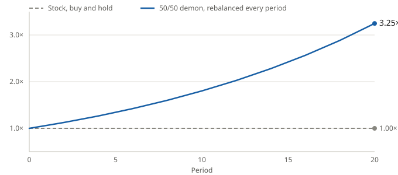

# Shannon's demon

A constant-rebalanced portfolio (CRP). It holds fixed target weights and restores them on a schedule, so it earns growth from volatility rather than from trend. This repo holds a build-and-apply spec, a reference implementation, and acceptance tests, so a person or an LLM can rebuild it, check it, and apply it.

## Contents

- `docs/shannons_demon_llm_spec.md`: the full spec. Definitions, math, build algorithm, acceptance test, application procedure, failure modes and output contract.
- `shannons_demon.py`: reference implementation with the simulator, buy-and-hold benchmark and summary metrics.
- `test_shannons_demon.py`: acceptance tests that encode the spec's expected values.
- `excel/shannons_demon.xlsx`: the same model as live Excel formulas, with inputs, a row-by-row demon, buy-and-hold, and summary.
- `excel/ShannonsDemon.bas`: VBA module that adds a weight sweep (`SweepWeights`) to the workbook.

## Quick start

Python:

```bash
pip install -r requirements.txt
python shannons_demon.py
python -m pytest -q
```

Excel:

1. Open `excel/shannons_demon.xlsx`. Change the yellow cells on `Inputs`. Results appear on `Summary`.
2. For the weight sweep, press Alt+F11, then File, Import File, and choose `excel/ShannonsDemon.bas`. Save the workbook as `.xlsm`, because `.xlsx` cannot hold macros. Run `SweepWeights` from Alt+F8.

The workbook recalculates without macros. Its formulas match the Python reference for the test scenarios checked at build time. The VBA macro has not been run in Excel. Its logic was checked line by line against the Python code.

## Worked example



A stock doubles or halves each period with equal odds. Its geometric return is 0%. A 50/50 mix of the stock and cash grows about 6.07% per period. After 20 periods it reaches about 3.25×, while the stock alone ends at 1.0×.

## Caveats

This is a teaching and research project, not investment advice. The cost model is one-way and proportional. It ignores taxes, spreads that vary with size, and financing. Test any application out of sample, against buy-and-hold, and net of realistic costs before relying on it.
